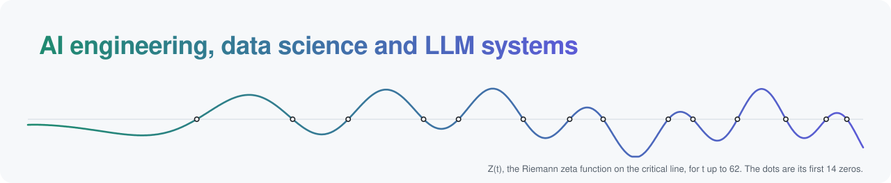
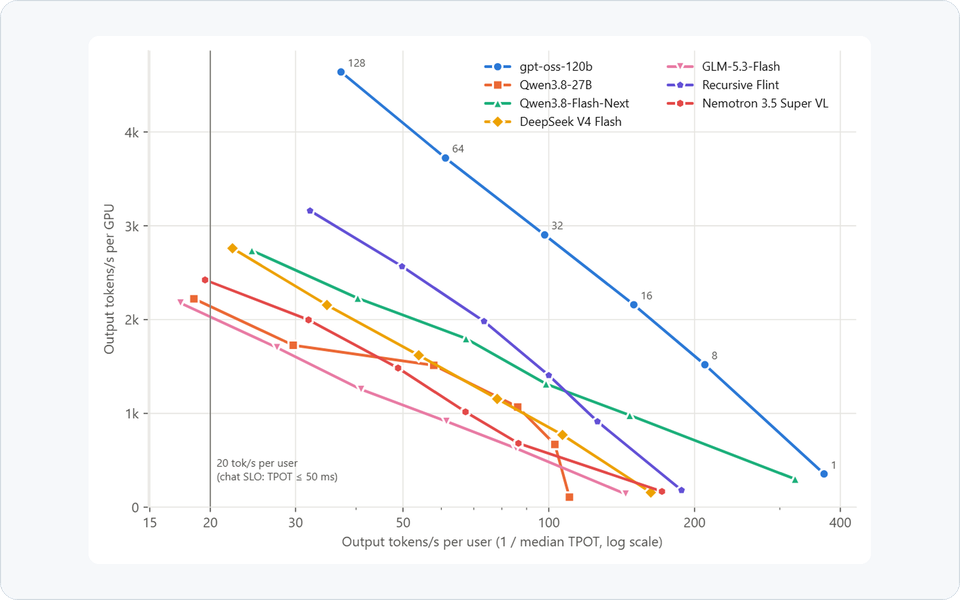
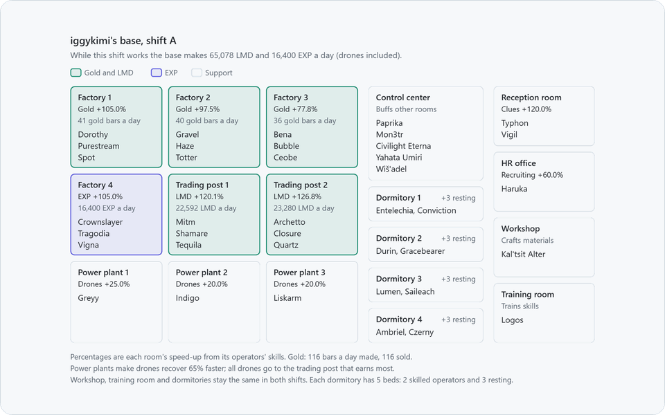
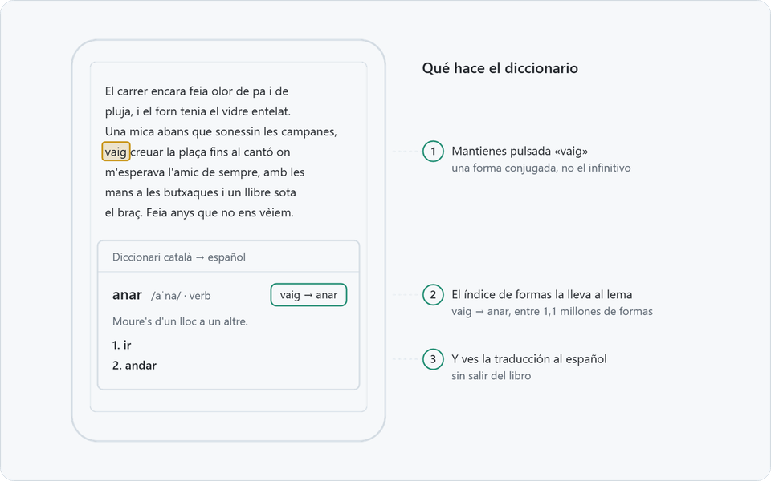
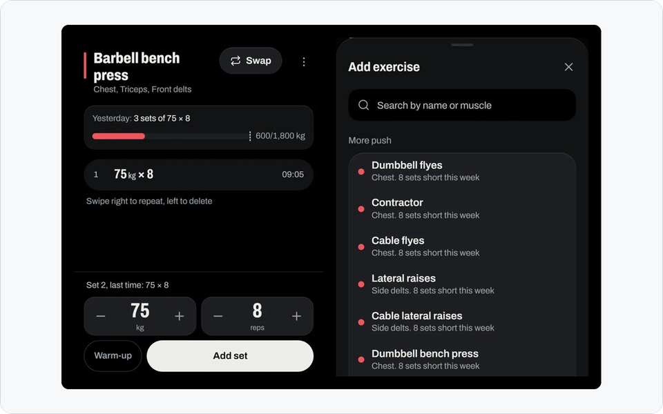
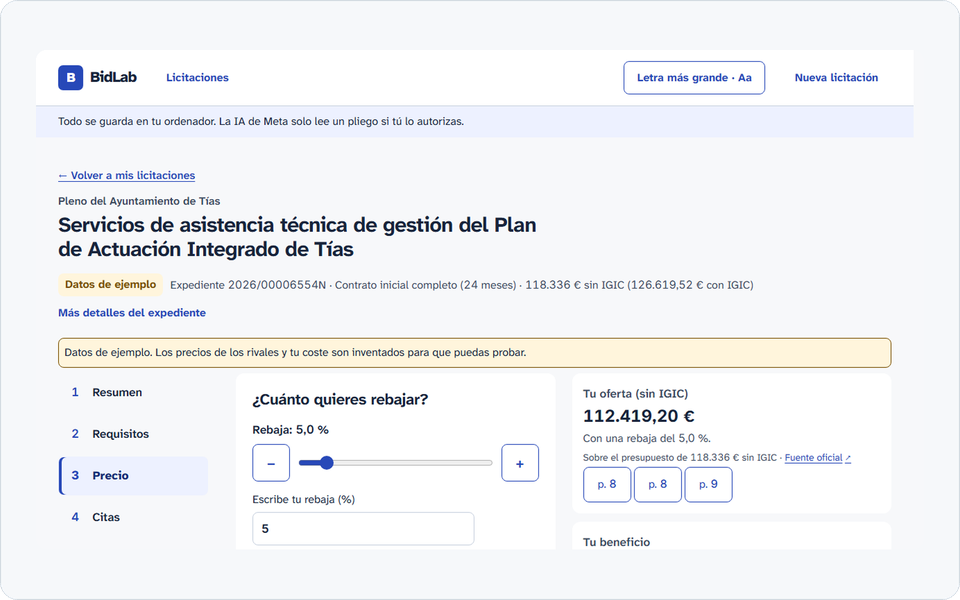

<picture>
  <source media="(prefers-color-scheme: dark)" srcset="docs/img/header-dark.svg">
  
</picture>

# Ignacio Montero Gil

AI engineer, data scientist and mathematician in Zaragoza, Spain. I build AI systems end to end and take them to production: LLM agents, machine learning models and the software around them. I measure how well they work before they ship.

Since April 2025 I work at [Integra Tecnología](https://www.integra3.com), where I own the architecture and most of the development of client projects in banking, industry, healthcare, the public sector and logistics. Before that, at KPMG (2024–2025), I automated financial-control processes for a bank with Python, SQL, PostgreSQL, R and Docker.

Client code stays private. What is here are side projects and one benchmark I ran at work and was able to publish, each with its data, tests and limits written down.

## Selected projects

<table>
<tr>
<td width="42%"><a href="https://github.com/iggykimi/iggybench"><picture><source media="(prefers-color-scheme: dark)" srcset="docs/img/cards/iggybench-dark.png"></picture></a></td>
<td>

**[IggyBench](https://github.com/iggykimi/iggybench)** · Python, vLLM

Seven open-weight LLMs and eleven specialist models on one NVIDIA GB300, over three days. How many chat users one machine serves under a P95 latency target, answer quality per use case with confidence intervals, energy per token and cost per million tokens. Every figure is recomputed from the raw data by scripts in the repo.

</td>
</tr>
<tr>
<td><a href="https://github.com/iggykimi/Arknights-Base"><picture><source media="(prefers-color-scheme: dark)" srcset="docs/img/cards/arknights-dark.png"></picture></a></td>
<td>

**[Arknights-Base](https://github.com/iggykimi/Arknights-Base)** · Python, SciPy MILP

A planner for a game's base-building layer. It turns a player's roster into a production model and picks the two-shift staffing with mixed-integer linear programming. On my roster the plan makes 12% more per day than filling the rooms greedily. Each formula cites the spreadsheet cell it comes from and is tested against the game's own data.

</td>
</tr>
<tr>
<td><a href="https://github.com/iggykimi/catalan-spanish-kindle-dictionary"><picture><source media="(prefers-color-scheme: dark)" srcset="docs/img/cards/dictionary-dark.png"></picture></a></td>
<td>

**[Catalan → Spanish Kindle dictionary](https://github.com/iggykimi/catalan-spanish-kindle-dictionary)** · Python

A free dictionary for Kindle e-readers: 54.5k headwords and about 1.1M inflected forms, so conjugated verbs and apostrophe contractions resolve to the right entry. A pipeline merges FreeDict, Softcatalà and Apertium and checks the binary format after every build. Coverage is measured token by token on real books.

</td>
</tr>
<tr>
<td><a href="https://github.com/iggykimi/setrack-web"><picture><source media="(prefers-color-scheme: dark)" srcset="docs/img/cards/setrack-dark.png"></picture></a></td>
<td>

**[SetRack](https://github.com/iggykimi/setrack-web)** · TypeScript, React, Capacitor

A gym log for Android, [published on Google Play](https://play.google.com/store/apps/details?id=com.setrack.app). Offline, no account and no internet permission: the data stays on the phone. 11 languages, about 450 automated tests, and layout checks that fail the build when a text overflows in any language. The app code is private; the landing site is public.

</td>
</tr>
<tr>
<td><a href="https://github.com/iggykimi/bidlab"><picture><source media="(prefers-color-scheme: dark)" srcset="docs/img/cards/bidlab-dark.png"></picture></a></td>
<td>

**[BidLab](https://github.com/iggykimi/bidlab)** · Python, FastAPI, React

A nine-day hackathon prototype. An LLM reads a Spanish public-tender PDF and proposes requirements with page citations, a person approves them, and a deterministic engine computes price, points and the abnormally-low-offer rule. The model never touches the arithmetic.

</td>
</tr>
</table>

## How I work with coding agents

I write most code with AI agents (Claude Code, OpenCode) and treat them as fast contributors who need a spec and a reviewer. Repos under active work have an `AGENTS.md` with the rules the agent works under: what is generated and must not be edited, which tests gate a change, which numbers come from an external source and must be checked against it. Examples: [Arknights-Base](https://github.com/iggykimi/Arknights-Base/blob/master/AGENTS.md), [BidLab](https://github.com/iggykimi/bidlab/blob/main/AGENTS.md).

The agent writes, and I decide what to build, set the checks and read the results. A change is done when the tests or a reproducible run say so.

## At work

- Agent systems and workflows with RAG, tool calling and MCP over the client's tools, APIs and data
- Conversational assistants and text-to-SQL over corporate databases
- Document AI: OCR and vision, LLM extraction, validation and integration with the client's systems
- Taking AI apps to production: FastAPI, tests and evals, observability, Docker, CI/CD, cloud deployment
- Machine learning models and mathematical optimisation for business problems
- Discovery, architecture and proofs of concept with clients
- Workshops and training on generative AI and agents for more than 30 companies and public bodies

2nd prize at the HACK THE VIBE hackathon, with automatic requirement extraction and eligibility checking over Spanish public tenders.

## Education and certifications

- MSc in Mathematics and Computer Science, Universidad de Zaragoza (2023). Thesis: NLP on financial markets, using BERT and sentiment analysis to study the impact of financial news.
- BSc in Mathematics, Universidad de Zaragoza (2022). Thesis on the Riemann zeta function.
- Microsoft Certified: AI Agent Builder Associate (2026).
- English C1, Oxford Test of English Advanced, 163/170 (2026). Native Spanish; professional French.

## Open source

Small fixes in the agent tools I use daily, mostly documentation that had drifted from the code: five merged pull requests in [oh-my-pi](https://github.com/can1357/oh-my-pi/pulls?q=is%3Apr+author%3Aiggykimi) (MCP protocol details, Anthropic prompt-caching notes, a Hermes tool-call dialect page).

## Stack

Python · pandas · scikit-learn · PyTorch · SciPy · LangGraph · vLLM · SGLang · FastAPI · Pydantic · PostgreSQL · pgvector · Docker · Azure · TypeScript · React · pytest · Playwright · Ruff

[LinkedIn](https://www.linkedin.com/in/ignacio-montero-gil)
